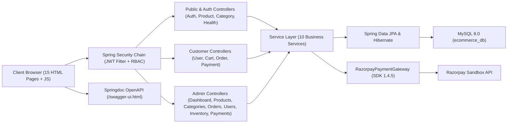
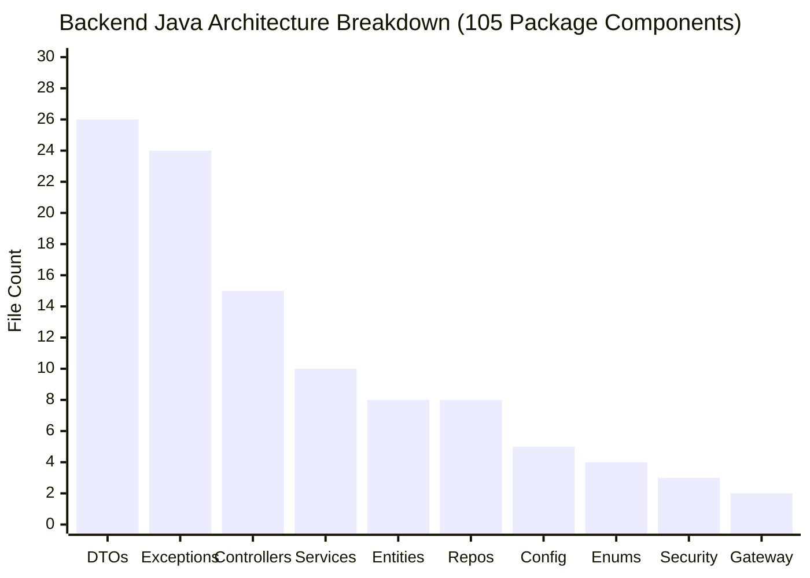
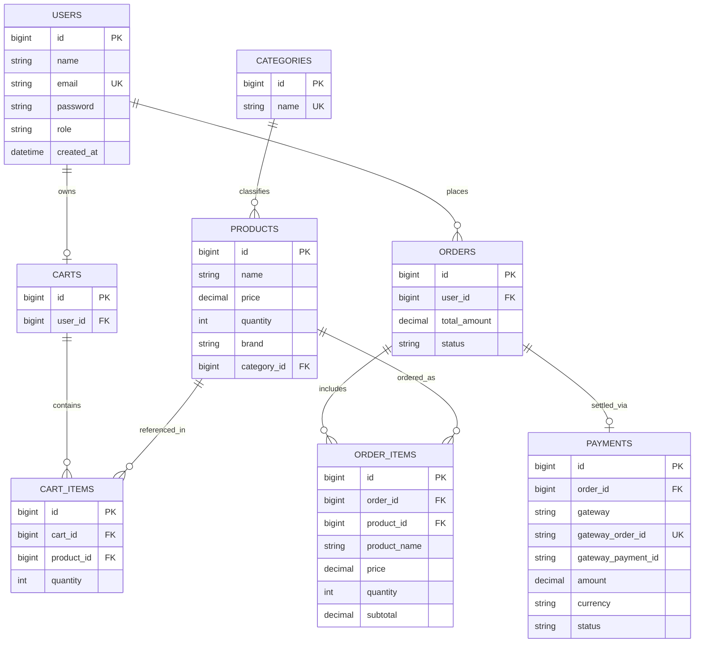
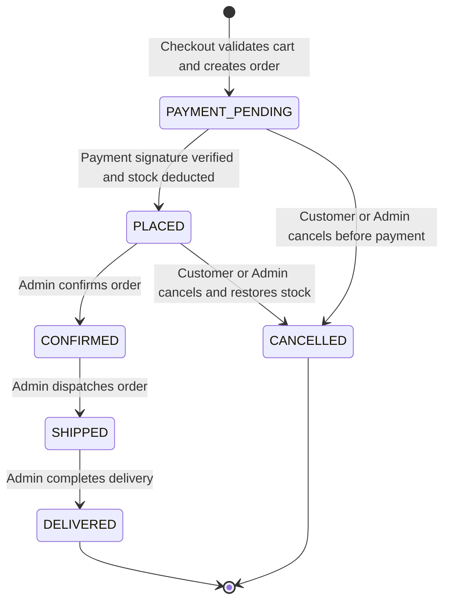
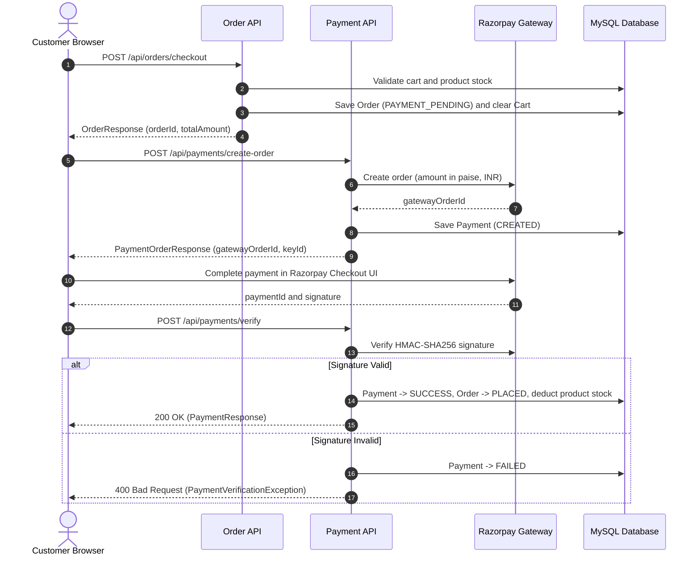
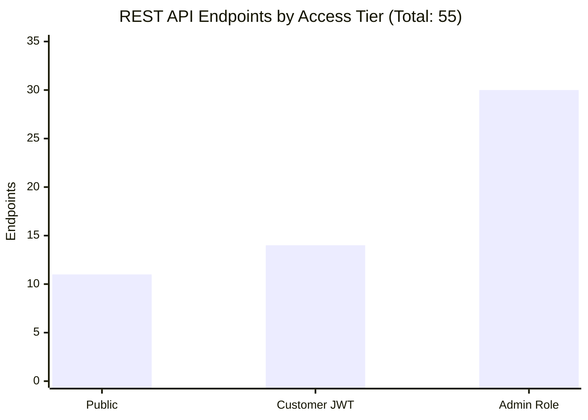

# JMart 


![Java](https://img.shields.io/badge/Java-17-007396?style=flat-square&logoColor=white&logo=)


A production-ready e-commerce platform with comprehensive backend API and modern frontend. Built with Java Spring Boot and featuring Razorpay payment integration, JWT authentication, and a beautiful animated landing page.

## Features

JMart separates storefront shopping, order orchestration, payment verification, and administrative control into modular Spring Boot services paired with a responsive Bootstrap 5 storefront.

| Domain | Capabilities | Key Components |
| :--- | :--- | :--- |
| **Authentication & Access** | Stateless JWT (`HS256`) login, BCrypt hashing, self-registration, and role-based route protection (`CUSTOMER` / `ADMIN`) | `AuthController`, `JwtService`, `SecurityConfig` |
| **Product & Catalog** | Full CRUD, keyword search, brand lookup, price-range filtering, category association, and duplicate-category checks | `ProductController`, `CategoryController` |
| **Storefront UI & UX** | Animated landing showcase, 4-slide hero banner, 16-category quick bar, unified header, profile menu, and product detail views | `landing.html`, `index.html`, `product-details.html` |
| **Shopping Cart** | Persistent per-user cart, real-time item quantity updates, stock validation, subtotal calculation, and cart clearing | `CartController`, `CartService`, `cart.html` |
| **Order Lifecycle** | Transactional checkout, `PAYMENT_PENDING` staging, order history tracking, customer cancellation, and stock restoration | `OrderController`, `OrderService`, `orders.html` |
| **Razorpay Payments** | Order creation in paise (`INR`), idempotent retry reuse, HMAC-SHA256 signature verification, and post-payment stock deduction | `PaymentController`, `RazorpayPaymentGateway` |
| **Admin Portal** | KPI dashboard (users, orders, revenue, stock alerts), user role promotion with last-admin guard, inventory thresholds, and payment audit | `Admin*Controller`, `admin-*.html` |
| **API Documentation** | Interactive OpenAPI 3 / Swagger UI with Bearer JWT authorization support and `/api/health` probe | `OpenApiConfig`, `HealthController` |

<details>
<summary><b>Interactive Explorer — Storefront Pages (15 HTML Views) & 16 Navigation Categories</b></summary>

#### Frontend Pages Classification

| Portal | Page | Script Module | Purpose |
| :--- | :--- | :--- | :--- |
| **Public & Auth** | `landing.html` (served at `/`) | — | Animated JMart landing showcase with floating category cards |
| **Public & Auth** | `login.html` | `login.js` | JWT login and role-based redirection |
| **Public & Auth** | `register.html` | `register.js` | New `CUSTOMER` registration with validation |
| **Storefront** | `index.html` | `products.js` | Main catalog, search, 16-category bar, and 4-slide promo carousel |
| **Storefront** | `product-details.html` | `product-details.js` | Product detail view and add-to-cart action |
| **Customer (JWT)** | `cart.html` | `cart.js` | Cart item management, quantity updates, and checkout trigger |
| **Customer (JWT)** | `checkout.html` | `checkout.js`, `payment.js` | Order creation and Razorpay Checkout modal integration |
| **Customer (JWT)** | `order-success.html` | `order-success.js` | Post-verification order confirmation screen |
| **Customer (JWT)** | `orders.html` | `orders.js` | Customer order history, status tracking, and cancellations |
| **Customer (JWT)** | `profile.html` | `profile.js` | User profile view and account updates |
| **Admin (`ROLE_ADMIN`)** | `admin-dashboard.html` | `admin-dashboard.js` | Store KPI summary and quick navigation |
| **Admin (`ROLE_ADMIN`)** | `admin-products.html` | `admin-products.js` | Product and category CRUD console |
| **Admin (`ROLE_ADMIN`)** | `admin-orders.html` | `admin-orders.js` | Order inspection and status progression |
| **Admin (`ROLE_ADMIN`)** | `admin-users.html` | `admin-users.js` | User directory and `CUSTOMER` / `ADMIN` role management |
| **Admin (`ROLE_ADMIN`)** | `admin-inventory.html` | `admin-inventory.js` | Stock monitoring (`IN_STOCK`, `LOW_STOCK`, `OUT_OF_STOCK`) and replenishment |

#### 16 Storefront Navigation Categories (`index.html`)

| Group | Categories |
| :--- | :--- |
| **Discovery & Style** | `For You` · `Fashion` · `Beauty` · `Books` |
| **Tech & Devices** | `Mobiles` · `Electronics` · `Appliances` · `Gaming` |
| **Living & Daily Needs** | `Furniture` · `Food & Health` · `Health` · `Toys, Baby & More` |
| **Mobility & Lifestyle** | `Auto Accessories` · `2 Wheelers` · `Sports & Fitness` · `Music` |

</details>

> **Quick Jump:** [Architecture](#architecture) · [Tech Stack](#tech-stack) · [Data Model & Lifecycles](#data-model--lifecycles) · [Installation & Setup](#installation--setup) · [Project Structure](#project-structure) · [API Reference](#api-reference) · [Security & Errors](#security--error-handling) · [Testing & Troubleshooting](#testing--troubleshooting)

---

## Architecture

JMart runs as a single Spring Boot application serving static frontend assets from `classpath:/frontend/` alongside a stateless REST API under `/api/**`.



### Codebase Composition



---

## Tech Stack

| Layer | Technology | Version | Purpose |
| :--- | :--- | :--- | :--- |
| **Runtime & Language** | Java | `17` | Core backend language (`maven.compiler.source/target=17`) |
| **Application Framework** | Spring Boot (Web, Validation) | `3.2.0` | Embedded server, REST controllers, Jakarta bean validation |
| **Persistence & ORM** | Spring Data JPA / Hibernate | Spring Boot `3.2.0` | Repository abstractions and entity mapping |
| **Database** | MySQL (`mysql-connector-j`) | `8.0+` | Relational persistence in `ecommerce_db` |
| **Security & Auth** | Spring Security + JJWT | `0.11.5` | Stateless JWT bearer auth (`HS256`) and BCrypt hashing |
| **Payment Gateway** | Razorpay Java SDK | `1.4.5` | Server-side order creation and HMAC signature verification |
| **API Documentation** | Springdoc OpenAPI UI | `2.2.0` | Interactive Swagger UI and `/v3/api-docs` schema |
| **Utilities & Build** | Maven Wrapper + Lombok | `3.9` | Dependency management, compilation, and executable JAR packaging |
| **Frontend UI** | HTML5, CSS3, ES6+ JS, Bootstrap | `5.3.3` | Responsive storefront, admin console, and Fetch API client |
| **Iconography** | FontAwesome | `6.5.1` | Storefront category icons, header actions, and footer badges |

---

## Data Model & Lifecycles

### Entity Relationship Schema



### Domain Classifications

| Classification | Enum Values | Rules & Operational Semantics |
| :--- | :--- | :--- |
| **User Roles (`Role`)** | `CUSTOMER`, `ADMIN` | New registrations default to `CUSTOMER`. `DataInitializer` seeds an initial `ADMIN` on startup. `AdminUserService` blocks demoting the final `ADMIN` (`LastAdminException`). |
| **Order Status (`OrderStatus`)** | `PAYMENT_PENDING`, `PLACED`, `CONFIRMED`, `SHIPPED`, `DELIVERED`, `CANCELLED` | Checkout creates `PAYMENT_PENDING`. Verified payment advances to `PLACED` and deducts stock. `AdminDashboardService` counts revenue strictly from `DELIVERED` orders. |
| **Payment Status (`PaymentStatus`)** | `CREATED`, `PENDING`, `SUCCESS`, `FAILED`, `CANCELLED` | Gateway order creation saves `CREATED` (`INR`). Re-initiating a `CREATED`/`PENDING` payment reuses the existing gateway order; a `FAILED` record is replaced. |
| **Stock Status (`StockStatus`)** | `IN_STOCK`, `LOW_STOCK`, `OUT_OF_STOCK` | Computed in `AdminInventoryService` using `LOW_STOCK_THRESHOLD` (default `10`): `0` = `OUT_OF_STOCK`, `1..threshold` = `LOW_STOCK`, `> threshold` = `IN_STOCK`. |

### Order Status Lifecycle



### Checkout & Razorpay Payment Verification Flow

> [!NOTE]
> **Transactional Stock Guarantee:** `OrderService.checkout()` validates available stock and clears the cart without deducting inventory yet. Stock is deducted atomically inside `PaymentService.verifyPayment()` only after Razorpay's HMAC-SHA256 signature is verified, and restored if a `PLACED` order is cancelled by the customer (`OrderService.cancelOrder()`).



---

## Installation & Setup

### Prerequisites

| Requirement | Minimum Version | Purpose | Notes |
| :--- | :--- | :--- | :--- |
| **Java JDK** | `17+` | Compile and run Spring Boot backend | Verified with `pom.xml` Java 17 target |
| **MySQL Server** | `8.0+` | Primary relational database | Must be reachable on `localhost:3306` |
| **Maven** | `3.9+` or `./mvnw.cmd` | Build and dependency resolution | Windows wrapper `mvnw.cmd` is included |
| **Razorpay Account** | Sandbox / Test Mode | Payment order creation & verification | Requires Test `Key ID` and `Key Secret` |

### Environment Variables (`application.properties`)

| Variable | Required | Default Value | Description |
| :--- | :---: | :--- | :--- |
| `DB_PASSWORD` | **Yes** | — | MySQL `root` password for `jdbc:mysql://localhost:3306/ecommerce_db` |
| `RAZORPAY_KEY_ID` | **Yes** | — | Razorpay API Key ID (`TEST`/`SANDBOX` mode) |
| `RAZORPAY_KEY_SECRET` | **Yes** | — | Razorpay API Key Secret used for client init and HMAC verification |
| `RAZORPAY_WEBHOOK_SECRET` | **Yes** | — | Razorpay webhook secret placeholder bound in `RazorpayConfig` |
| `JWT_SECRET` | Recommended | Dev fallback key in properties | 256-bit+ secret for signing JWTs |
| `JWT_EXPIRATION` | Optional | `86400000` (24h in ms) | JWT token expiration duration |
| `ADMIN_EMAIL` | Optional | `admin@ecommerce.com` | Seeded admin email created on first startup |
| `ADMIN_PASSWORD` | Optional | `Admin@123` | Seeded admin password (BCrypt-encoded on creation) |
| `LOW_STOCK_THRESHOLD` | Optional | `10` | Quantity cutoff (`<= threshold`) for `LOW_STOCK` classification |

> [!IMPORTANT]
> `DB_PASSWORD`, `RAZORPAY_KEY_ID`, `RAZORPAY_KEY_SECRET`, and `RAZORPAY_WEBHOOK_SECRET` have no defaults in [application.properties](src/main/resources/application.properties) and must be set in your environment before startup. Override `JWT_SECRET` and `ADMIN_PASSWORD` in any shared or production deployment.

### Step-by-Step Setup

1. **Clone the repository and prepare MySQL** (Spring JDBC also includes `createDatabaseIfNotExist=true`):

```bash
git clone <repository-url>
cd "E-Commerce Platform"
```

```sql
CREATE DATABASE IF NOT EXISTS ecommerce_db;
```

2. **Export environment variables for your shell:**

<details>
<summary><b>Windows (PowerShell) — Environment Variables & Launch</b></summary>

```powershell
$env:DB_PASSWORD="your_mysql_password"
$env:RAZORPAY_KEY_ID="rzp_test_your_key_id"
$env:RAZORPAY_KEY_SECRET="your_razorpay_key_secret"
$env:RAZORPAY_WEBHOOK_SECRET="your_razorpay_webhook_secret"

.\mvnw.cmd spring-boot:run
```

</details>

<details>
<summary><b>Windows (Command Prompt) — Environment Variables & Launch</b></summary>

```cmd
set DB_PASSWORD=your_mysql_password
set RAZORPAY_KEY_ID=rzp_test_your_key_id
set RAZORPAY_KEY_SECRET=your_razorpay_key_secret
set RAZORPAY_WEBHOOK_SECRET=your_razorpay_webhook_secret

mvnw.cmd spring-boot:run
```

</details>

<details>
<summary><b>Linux / macOS (Bash/Zsh) — Environment Variables & Launch</b></summary>

```bash
export DB_PASSWORD="your_mysql_password"
export RAZORPAY_KEY_ID="rzp_test_your_key_id"
export RAZORPAY_KEY_SECRET="your_razorpay_key_secret"
export RAZORPAY_WEBHOOK_SECRET="your_razorpay_webhook_secret"

mvn spring-boot:run
```

</details>

3. **Build a standalone executable JAR (optional):**

```bash
.\mvnw.cmd clean package
java -jar target/ecommerce-1.0.0.jar
```

### Access Points

| Surface | URL | Auth Required | Description |
| :--- | :--- | :--- | :--- |
| **Landing Page** | `http://localhost:8080/` | Public | Animated JMart welcome page (`landing.html`) |
| **Storefront Catalog** | `http://localhost:8080/index.html` | Public | Product catalog, search, filters, and category bar |
| **Admin Portal** | `http://localhost:8080/admin-dashboard.html` | `ADMIN` | Store KPI dashboard and admin management views |
| **Swagger UI** | `http://localhost:8080/swagger-ui.html` | Public | Interactive OpenAPI 3 documentation & Bearer tester |
| **Health Probe** | `http://localhost:8080/api/health` | Public | Returns `"E-Commerce API is running"` |
| **REST API Base** | `http://localhost:8080/api` | Varies | Root base URL consumed by `frontend/js/api.js` |

---

## Project Structure

### Module Overview

| Module Path | Component Count | Responsibility |
| :--- | :---: | :--- |
| `com.ecommerce.ecommerce.config` | 5 classes | `SecurityConfig`, `RazorpayConfig`, `WebMvcConfig`, `OpenApiConfig`, `DataInitializer` |
| `com.ecommerce.ecommerce.controller` | 15 classes | 8 storefront/core controllers + 7 `Admin*Controller` classes |
| `com.ecommerce.ecommerce.service` | 10 classes | Business logic for auth, catalog, cart, orders, payments, and admin operations |
| `com.ecommerce.ecommerce.entity` | 8 classes | JPA entities (`User`, `Category`, `Product`, `Cart`, `CartItem`, `Order`, `OrderItem`, `Payment`) |
| `com.ecommerce.ecommerce.repository` | 8 interfaces | Spring Data JPA repositories and atomic stock updates |
| `com.ecommerce.ecommerce.dto` | 26 classes | Validated request payloads and structured API response DTOs |
| `com.ecommerce.ecommerce.enums` | 4 enums | `Role`, `OrderStatus`, `PaymentStatus`, `StockStatus` |
| `com.ecommerce.ecommerce.exception` | 24 classes | `GlobalExceptionHandler`, response schemas, and domain-specific exceptions |
| `com.ecommerce.ecommerce.security` | 3 classes | `JwtService`, `JwtAuthenticationFilter`, `CustomUserDetailsService` |
| `com.ecommerce.ecommerce.gateway` | 2 classes | `PaymentGateway` interface and `RazorpayPaymentGateway` adapter |
| `src/main/resources/frontend` | 15 HTML · 18 JS · 8 CSS | Responsive storefront & admin pages + FontAwesome + [API_MAPPING.md](src/main/resources/frontend/API_MAPPING.md) |

<details>
<summary><b>Expand Full Directory Tree</b></summary>

```text
E-Commerce Platform/
├── src/main/java/com/ecommerce/ecommerce/
│   ├── EcommerceApplication.java
│   ├── config/
│   │   ├── DataInitializer.java
│   │   ├── OpenApiConfig.java
│   │   ├── RazorpayConfig.java
│   │   ├── SecurityConfig.java
│   │   └── WebMvcConfig.java
│   ├── controller/
│   │   ├── AuthController.java
│   │   ├── CartController.java
│   │   ├── CategoryController.java
│   │   ├── HealthController.java
│   │   ├── OrderController.java
│   │   ├── PaymentController.java
│   │   ├── ProductController.java
│   │   ├── UserController.java
│   │   ├── AdminCategoryController.java
│   │   ├── AdminDashboardController.java
│   │   ├── AdminInventoryController.java
│   │   ├── AdminOrderController.java
│   │   ├── AdminPaymentController.java
│   │   ├── AdminProductController.java
│   │   └── AdminUserController.java
│   ├── dto/                  # 26 Request/Response DTOs
│   ├── entity/               # User, Category, Product, Cart, CartItem, Order, OrderItem, Payment
│   ├── enums/                # Role, OrderStatus, PaymentStatus, StockStatus
│   ├── exception/            # GlobalExceptionHandler, ErrorResponse, ValidationErrorResponse + 21 exceptions
│   ├── gateway/              # PaymentGateway, RazorpayPaymentGateway
│   ├── repository/           # 8 Spring Data JPA repositories
│   ├── security/             # JwtService, JwtAuthenticationFilter, CustomUserDetailsService
│   └── service/              # 10 business & admin services
├── src/main/resources/
│   ├── application.properties
│   └── frontend/
│       ├── API_MAPPING.md
│       ├── landing.html, index.html, login.html, register.html
│       ├── product-details.html, cart.html, checkout.html, order-success.html, orders.html, profile.html
│       ├── admin-dashboard.html, admin-products.html, admin-orders.html, admin-users.html, admin-inventory.html
│       ├── assets/Icons/j-solid-full.svg
│       ├── css/              # 8 stylesheets + fontawesome/
│       └── js/               # 18 modular scripts (api.js, auth.js, common.js, payment.js, page modules)
├── LICENSE
├── mvnw.cmd
├── pom.xml
└── README.md
```

</details>

---

## API Reference

The backend exposes **55 REST endpoints** across **15 controllers**. All protected endpoints require the `Authorization: Bearer <JWT_TOKEN>` header. See [API_MAPPING.md](src/main/resources/frontend/API_MAPPING.md) for sample DTO payloads.



### Endpoint Classification Summary

| Domain | Controller(s) | Base Path | Endpoints | Access Scope |
| :--- | :--- | :--- | :---: | :--- |
| **Health & Auth** | `HealthController`, `AuthController` | `/api/health`, `/api/auth` | 3 | Public |
| **Catalog (Read)** | `ProductController`, `CategoryController` | `/api/products`, `/api/categories` | 8 | Public (`GET`) |
| **Catalog (Write)** | `ProductController`, `CategoryController` | `/api/products`, `/api/categories` | 6 | `ADMIN` (`POST`/`PUT`/`DELETE`) |
| **Users** | `UserController` | `/api/users` | 2 | Self or `ADMIN` |
| **Shopping Cart** | `CartController` | `/api/cart` | 5 | Authenticated |
| **Orders** | `OrderController` | `/api/orders` | 4 | Authenticated |
| **Payments** | `PaymentController` | `/api/payments` | 3 | Authenticated |
| **Admin Portal** | 7 `Admin*Controller` classes | `/api/admin/**` | 24 | `ADMIN` only |

<details>
<summary><b>🌐 Public & Authentication Endpoints (11 Endpoints)</b></summary>

| Method | Endpoint | Controller | Description |
| :---: | :--- | :--- | :--- |
| `GET` | `/api/health` | `HealthController` | Service liveness check |
| `POST` | `/api/auth/register` | `AuthController` | Register new `CUSTOMER` account |
| `POST` | `/api/auth/login` | `AuthController` | Authenticate credentials and issue JWT |
| `GET` | `/api/products` | `ProductController` | List all products |
| `GET` | `/api/products/{id}` | `ProductController` | Get product details by ID |
| `GET` | `/api/products/search?name={name}` | `ProductController` | Search products by name |
| `GET` | `/api/products/brand/{brand}` | `ProductController` | Filter products by brand |
| `GET` | `/api/products/filter?minPrice={min}&maxPrice={max}` | `ProductController` | Filter products by price range |
| `GET` | `/api/products/category/{categoryId}` | `ProductController` | List products in a category |
| `GET` | `/api/categories` | `CategoryController` | List all categories |
| `GET` | `/api/categories/{id}` | `CategoryController` | Get category details by ID |

</details>

<details>
<summary><b>🛒 Authenticated Customer Endpoints (14 Endpoints — Requires JWT)</b></summary>

| Method | Endpoint | Access Rule | Description |
| :---: | :--- | :--- | :--- |
| `GET` | `/api/users/{id}` | Self or `ADMIN` | Retrieve user profile by ID |
| `PUT` | `/api/users/{id}` | Self or `ADMIN` | Update user profile details |
| `GET` | `/api/cart` | Authenticated | Retrieve current user's cart |
| `POST` | `/api/cart/items` | Authenticated | Add product item to cart |
| `PUT` | `/api/cart/items/{itemId}` | Authenticated | Update cart item quantity |
| `DELETE` | `/api/cart/items/{itemId}` | Authenticated | Remove item from cart |
| `DELETE` | `/api/cart` | Authenticated | Clear all items from cart |
| `POST` | `/api/orders/checkout` | Authenticated | Create `PAYMENT_PENDING` order from cart |
| `GET` | `/api/orders` | Authenticated | List current user's order history |
| `GET` | `/api/orders/{orderId}` | Authenticated | Get specific order details |
| `PUT` | `/api/orders/{orderId}/cancel` | Authenticated | Cancel `PAYMENT_PENDING` or `PLACED` order |
| `POST` | `/api/payments/create-order` | Authenticated | Create Razorpay order (`INR`) for pending order |
| `POST` | `/api/payments/verify` | Authenticated | Verify Razorpay payment signature and confirm order |
| `GET` | `/api/payments/order/{orderId}` | Authenticated | Fetch payment status for a user order |

</details>

<details>
<summary><b>🛡️ Admin Management Endpoints (30 Endpoints — Requires ROLE_ADMIN)</b></summary>

| Method | Endpoint | Controller | Description |
| :---: | :--- | :--- | :--- |
| `GET` | `/api/admin/dashboard` | `AdminDashboardController` | Aggregate users, products, orders, revenue (`DELIVERED`), and stock alerts |
| `POST` | `/api/products` | `ProductController` | Create product (root route) |
| `PUT` | `/api/products/{id}` | `ProductController` | Update product (root route) |
| `DELETE` | `/api/products/{id}` | `ProductController` | Delete product (root route) |
| `POST` | `/api/categories` | `CategoryController` | Create category (root route) |
| `PUT` | `/api/categories/{id}` | `CategoryController` | Update category (root route) |
| `DELETE` | `/api/categories/{id}` | `CategoryController` | Delete category (root route) |
| `GET` | `/api/admin/products` | `AdminProductController` | List all products (Admin) |
| `GET` | `/api/admin/products/{id}` | `AdminProductController` | Get product by ID (Admin) |
| `POST` | `/api/admin/products` | `AdminProductController` | Create product (Admin) |
| `PUT` | `/api/admin/products/{id}` | `AdminProductController` | Update product (Admin) |
| `DELETE` | `/api/admin/products/{id}` | `AdminProductController` | Delete product (Admin) |
| `GET` | `/api/admin/products/search?name={name}` | `AdminProductController` | Search products by name (Admin) |
| `GET` | `/api/admin/categories` | `AdminCategoryController` | List all categories (Admin) |
| `GET` | `/api/admin/categories/{id}` | `AdminCategoryController` | Get category by ID (Admin) |
| `POST` | `/api/admin/categories` | `AdminCategoryController` | Create category (Admin) |
| `PUT` | `/api/admin/categories/{id}` | `AdminCategoryController` | Update category (Admin) |
| `DELETE` | `/api/admin/categories/{id}` | `AdminCategoryController` | Delete category (Admin) |
| `GET` | `/api/admin/orders` | `AdminOrderController` | List all system orders |
| `GET` | `/api/admin/orders/{orderId}` | `AdminOrderController` | Inspect order details |
| `PUT` | `/api/admin/orders/{orderId}/status` | `AdminOrderController` | Advance order status (`PAYMENT_PENDING` → `DELIVERED`) |
| `GET` | `/api/admin/users` | `AdminUserController` | List all registered users |
| `GET` | `/api/admin/users/{id}` | `AdminUserController` | Inspect user account details |
| `PUT` | `/api/admin/users/{userId}/role` | `AdminUserController` | Update user role (`CUSTOMER` ↔ `ADMIN`) |
| `GET` | `/api/admin/inventory` | `AdminInventoryController` | List inventory with computed `StockStatus` |
| `GET` | `/api/admin/inventory/low-stock` | `AdminInventoryController` | Filter `LOW_STOCK` products (`<= threshold`) |
| `GET` | `/api/admin/inventory/out-of-stock` | `AdminInventoryController` | Filter `OUT_OF_STOCK` products (`quantity == 0`) |
| `PUT` | `/api/admin/inventory/{productId}` | `AdminInventoryController` | Set updated stock quantity |
| `GET` | `/api/admin/payments` | `AdminPaymentController` | Audit all payment records |
| `GET` | `/api/admin/payments/{paymentId}` | `AdminPaymentController` | Inspect individual payment record |

</details>

---

## Security & Error Handling

### Security Controls Matrix

| Layer | Mechanism | Implementation Detail |
| :--- | :--- | :--- |
| **Token Auth** | Stateless JWT (`JJWT 0.11.5`) | `JwtAuthenticationFilter` validates `Bearer` tokens and populates `SecurityContextHolder`; `SessionCreationPolicy.STATELESS`. |
| **Password Storage** | `BCryptPasswordEncoder` | Passwords hashed with BCrypt before persisting and excluded from JSON via `@JsonIgnore`. |
| **Authorization** | URL + Method RBAC | `SecurityConfig` URL matchers paired with `@EnableMethodSecurity` (`@PreAuthorize("hasRole('ADMIN')")` / `isAuthenticated()`). |
| **Self-Access & Admin Guard** | Ownership + Last-Admin Check | `UserController` restricts profile access to self or admin; `AdminUserService` forbids demoting the last `ADMIN`. |
| **Payment Integrity** | HMAC-SHA256 Verification | `RazorpayPaymentGateway` verifies `razorpay_order_id`, `razorpay_payment_id`, and `razorpay_signature` before confirming orders. |
| **Input & Query Safety** | Jakarta Validation + JPA | `@Valid` DTO constraints, parameterized JPA queries, and frontend `escapeHtml()` output escaping in `common.js`. |

### HTTP Error Classification (`GlobalExceptionHandler`)

| HTTP Status | Category | Mapped Exceptions |
| :---: | :--- | :--- |
| `400` | Validation / Bad Request | `MethodArgumentNotValidException`, `EmptyCartException`, `InvalidInventoryQuantityException`, `PaymentVerificationException` |
| `401` | Unauthenticated | `InvalidCredentialsException`, `AuthenticationException` |
| `403` | Forbidden | `AccessDeniedException`, `UnauthorizedAccessException` |
| `404` | Resource Not Found | `CategoryNotFoundException`, `ProductNotFoundException`, `UserNotFoundException`, `CartNotFoundException`, `CartItemNotFoundException`, `OrderNotFoundException`, `PaymentNotFoundException` |
| `409` | State / Business Conflict | `DuplicateEmailException`, `DuplicateCategoryException`, `CategoryInUseException`, `InsufficientStockException`, `InvalidOrderStatusException`, `LastAdminException`, `PaymentAlreadyCompletedException`, `InvalidPaymentStateException` |
| `500` | Gateway / Server Error | `PaymentCreationException`, unhandled `Exception` |

<details>
<summary><b>Inspect Standard Error & Validation JSON Payloads</b></summary>

Standard `ErrorResponse`:
```json
{
  "timestamp": "2026-11-27T10:30:00",
  "status": 404,
  "message": "Product not found with id: 99",
  "path": "/api/products/99"
}
```

Field `ValidationErrorResponse` (`400 Bad Request`):
```json
{
  "timestamp": "2026-11-27T10:30:00",
  "status": 400,
  "message": "Validation failed",
  "errors": {
    "password": "Password must be between 8 and 100 characters"
  }
}
```

</details>

---

## Testing & Troubleshooting

### Interactive & CLI Verification

1. **Swagger UI:** Start the server, open `http://localhost:8080/swagger-ui.html`, log in via `/api/auth/login`, click **Authorize**, and enter your JWT token.
2. **CLI Smoke Checks:**

<details>
<summary><b>Expand Manual curl Smoke Test Commands</b></summary>

```bash
# 1. Health check
curl http://localhost:8080/api/health

# 2. Register a customer (password must be 8-100 characters)
curl -X POST http://localhost:8080/api/auth/register \
  -H "Content-Type: application/json" \
  -d '{"name":"John Doe","email":"john@example.com","password":"Password123","phone":"9876543210","address":"Bengaluru, India"}'

# 3. Login to obtain a JWT token
curl -X POST http://localhost:8080/api/auth/login \
  -H "Content-Type: application/json" \
  -d '{"email":"john@example.com","password":"Password123"}'

# 4. Query catalog & protected cart endpoint
curl http://localhost:8080/api/products
curl -H "Authorization: Bearer <JWT_TOKEN>" http://localhost:8080/api/cart
```

</details>

### Troubleshooting Matrix

| Symptom | Likely Cause | Resolution |
| :--- | :--- | :--- |
| **Application fails on startup with placeholder error** | Missing required environment variables | Export `DB_PASSWORD`, `RAZORPAY_KEY_ID`, `RAZORPAY_KEY_SECRET`, and `RAZORPAY_WEBHOOK_SECRET` in the active terminal session. |
| **MySQL connection refused** | MySQL service stopped or wrong port/password | Ensure MySQL 8.0 is running on `localhost:3306`, verify `DB_PASSWORD`, and ensure `ecommerce_db` is accessible by `root`. |
| **Port `8080` already in use** | Previous server instance still running | Windows: `netstat -ano \| findstr :8080` then `taskkill /PID <PID> /F`. Linux/macOS: `lsof -i :8080` then `kill -9 <PID>`. |
| **Razorpay `create-order` returns `500`** | Invalid Razorpay test keys or network block | Confirm valid Razorpay Test/Sandbox keys are set in `RAZORPAY_KEY_ID` and `RAZORPAY_KEY_SECRET`. |
| **Maven compilation or dependency issues** | Stale target cache | Run `.\mvnw.cmd clean install` (or `mvn clean install`) to rebuild cleanly. |

---

## Development Milestones

| Phase | Milestone | Status | Summary |
| :---: | :--- | :---: | :--- |
| **1 – 2** | Core Setup & Catalog | ✅ Complete | Spring Boot 3.2, MySQL/JPA schema, `Product` & `Category` CRUD and search filters |
| **3 – 4** | Accounts & JWT Security | ✅ Complete | Customer registration, BCrypt hashing, `JwtService`, stateless `SecurityFilterChain` |
| **5 – 6** | Cart & Order Lifecycle | ✅ Complete | Persistent `Cart`, transactional checkout (`PAYMENT_PENDING`), order history & cancellation |
| **7** | Admin Suite & Analytics | ✅ Complete | 7 `Admin*Controller` endpoints for KPIs, orders, users, inventory thresholds, and payments |
| **8** | Razorpay Integration | ✅ Complete | `RazorpayPaymentGateway` order creation, HMAC verification, and post-payment stock deduction |
| **9 – 10** | JMart Storefront & UX | ✅ Complete | Animated landing showcase, 16-category navigation, unified header, profile menu, and 15 HTML views |

## Contributing

1. Fork the repository.
2. Create a feature branch (`git checkout -b feature/your-feature`).
3. Commit your changes (`git commit -m "Add your feature"`).
4. Push to your branch (`git push origin feature/your-feature`).
5. Open a Pull Request.

## License

This project is licensed under the MIT License — see the [LICENSE](LICENSE) file for details.

## Author & Acknowledgments

**Madhan Mohan Reddy (JMart Development Team)**

- **Spring Boot & Spring Security** — Application framework, data access, and JWT RBAC foundation
- **Razorpay** — Sandbox payment gateway SDK and signature verification
- **Bootstrap 5 & FontAwesome** — Responsive grid layout and storefront iconography
- **Springdoc OpenAPI** — Interactive API specification and Swagger UI

> [!WARNING]
> **Development Notice:** This project ships with development defaults in `application.properties` (such as `JWT_SECRET`, `ADMIN_PASSWORD`, `useSSL=false`, and permissive CORS patterns). Configure production secrets, SSL/TLS, strict CORS origins, and live Razorpay credentials before public deployment.

---

## Contact Information

### Madhan Mohan Reddy

- **Email**: <madhanmohanreddyperam06@gmail.com>
- **Mobile**: +91 9110395993

---
<div align="center">
© 2026 JMart. All rights reserved.
</div>